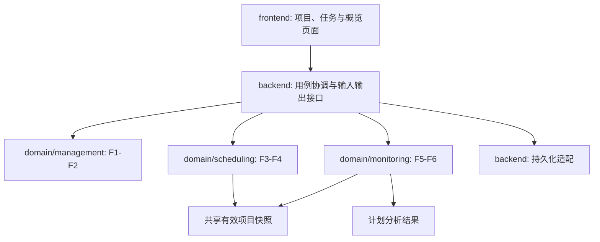

# 初始架构与模块边界

这是依据 proposal 第 7、9、10、13 节提出的初始实现结构，尚无业务代码。功能、计算语义和归属来自 proposal；目录划分、数据字段名称和接口形状是开发建议，需在第一周确认。语言、框架、数据库及部署方式尚未决定。

## 三层与三个功能区域

箭头表达调用或读取关系。领域规则不依赖页面、数据库或 Web 框架；不要求前端与后端使用同一种语言或直接共享代码包。

| 边界 | 职责 | 输入与输出 | 功能负责人 |
| --- | --- | --- | --- |
| [management](../src/domain/management/README.md) | 项目、成员、任务规则；同项目分配、工期校验、成员移除检查 | 编辑请求 + 现有记录 → 有效变更或明确错误 | ZhangWeiyi |
| [scheduling](../src/domain/scheduling/README.md) | 依赖合法性、拓扑顺序、正反向时间计算、关键活动 | 完整有效任务图 → 时序、工期、浮动时间、关键任务 | WeiMingrui |
| [monitoring](../src/domain/monitoring/README.md) | 阻塞、显示状态、完成率、关键工作及日期风险解释 | 项目快照 + 计划结果 + 当前日期 → 进度与风险概览 | ZhangYuyang |
| [backend](../src/backend/README.md) | 协调用例、持久化、接口错误、保存后重算与读取一致性 | 用户变更 → 保存的计划和最新结果 | 三人按功能协作，组长协调集成 |
| [frontend](../src/frontend/README.md) | 编辑流程、任务列表、依赖入口、概览与可理解的提示 | 服务返回的数据 → 页面；用户操作 → 请求 | 三人按功能协作 |

## 共享数据草案

字段名称是待实现约定，不是已经存在的 API 或数据库表。

| 记录 | 建议字段 | 规则来源 |
| --- | --- | --- |
| Project | `id`, `name`, `plannedStart`, `deadline` | F1；项目开始与截止日期 |
| Member | `id`, `projectId`, `name` | F1；成员属于项目 |
| Task | `id`, `projectId`, `name`, `assigneeId`, `durationDays`, `deadline`, `status` | F2；负责人必须属于同一项目，工期 > 0 |
| Dependency | `projectId`, `prerequisiteId`, `dependentId` | F3；同项目、不同任务、无重复、无循环 |
| ScheduleResult | 各任务 ES/EF/LS/LF/totalFloat、项目工期、关键任务 ID | F4；从有效图计算 |
| Overview | 显示状态、阻塞任务名、四类计数、完成率、风险说明 | F5–F6；每个任务只计入一个显示类别 |

`Task.status` 只保存 `Not Started`、`In Progress`、`Completed`。`Blocked` 是未完成前置任务导致的派生显示状态，并保留基础状态以供说明。日期边界、工期小数精度、删除关联任务/依赖的具体交互及状态一致性策略须在第一周补充，不在这里默认为已定规则。

## 变更与分析流程

1. 后端取得项目当前有效快照，领域模块校验输入、成员归属和依赖关系。
2. 对拟议变更形成候选图；非法依赖应带原因返回，原有效计划保持不变。
3. 保存有效源数据，依据同一份已保存快照计算最新计划、阻塞、进度和风险，并返回页面。
4. 重新打开项目时，从保存的源数据恢复并生成一致结果；具体事务和并发实现随技术栈确定。

任务增删、工期或依赖改变触发计划重算；起始日和截止日期改变更新日期比较；任务状态或依赖改变更新阻塞和进度；当前日期改变更新逾期提示。状态变化不自动缩短输入的计划工期，也不推断实际剩余工时。

计划结果是源数据的派生信息。初版优先在读取和有效变更后计算，不增加独立排程服务或复杂缓存。所有关键活动都要返回；不能只选取一条最长路径而遗漏并列关键任务。

## 计算约定与测试边界

流逝自然日、完成后才能开始的依赖、允许独立任务并行。拓扑顺序上做正向计算，再从项目最大完成时间反向计算浮动时间；零浮动时间的任务为关键活动。截止日期仅用于比较，不改变合法图的计算工期。日历、假期和资源约束不在首版范围。

领域测试不依赖数据库或浏览器；接口/保存一致性在后端集成测试覆盖；真实录入、拒绝循环、自动重算和概览解释在端到端场景覆盖。[测试入口](../tests/README.md)记录验收目标，fixture 提供独立期望。

下一步先在[REQUIREMENTS](REQUIREMENTS.md)解决待决业务细节，按[ROADMAP](ROADMAP.md)建立项目/任务保存闭环，再实现三个功能区域。技术选择确定后在此记录理由，并把真实启动和测试命令写回仓库首页。
