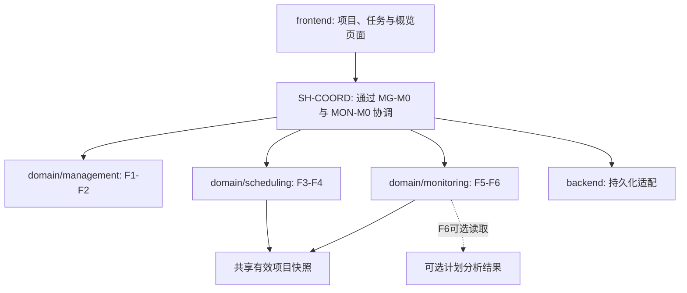

# 初始架构与模块边界

本文件在原有三功能区域上同步 2026-10-25 第二轮整合设计。修订版 URS 是需求核对依据，Chapter 6 提供模块化原则；三份个人报告提供待团队评审的模块细节。以下接口与快照协议均为 DRAFT 设计约定，不表示客户已批准、功能已实现或测试已通过。语言、框架、数据库、锁或比较保存机制仍待详细设计。

## 三层与三个功能区域

箭头表达调用或读取关系。领域规则不依赖页面、数据库或 Web 框架；不要求前端与后端使用同一种语言或直接共享代码包。

| 边界 | 职责 | 输入与输出 | 功能负责人 |
| --- | --- | --- | --- |
| [management](../src/domain/management/README.md) | MG-M0 门面及 MG-M1–M4：项目、成员/角色、任务和备注源记录；统一 MG-M2 权限策略 | 授权候选变更 → MutationResult 或 PublicError | ZhangWeiyi |
| [scheduling](../src/domain/scheduling/README.md) | DS-F3.1–3 验证与维护依赖；DS-F4.1–4 计算日程 | DependencyResultView、ScheduleResultView，均标明 sourceRevision 和 availability | WeiMingrui |
| [monitoring](../src/domain/monitoring/README.md) | MON-M0 门面及 MON-M1–7：F5 状态/进度/直接阻塞/分配/基本逾期；F6 三类可选警告 | DashboardResult，允许可靠基础数据与不可用能力并存 | ZhangYuyang |
| [backend](../src/backend/README.md) | 协调用例、持久化、接口错误、保存后重算与读取一致性 | 用户变更 → 保存的计划和最新结果 | 三人按功能协作，组长协调集成 |
| [frontend](../src/frontend/README.md) | 编辑流程、任务列表、依赖入口、概览与可理解的提示 | 服务返回的数据 → 页面；用户操作 → 请求 | 三人按功能协作 |

## 共享数据与职责契约

以下是统一概念字段，不是已实现的 API、数据库表或批准后的字段必填策略。活动契约不再使用同义版本字段或模糊的裸截止日期字段。

| 记录 | 统一字段 | 所有权或规则 |
| --- | --- | --- |
| ProjectSnapshot | `projectId`, `name`, `plannedStartDate`, `projectDeadline`, `members`, `tasks`, `dependencyView`, `revision` | SH-COORD 取得同一授权项目的连贯快照；F1/F2 拥有项目/任务源记录，F3 提供依赖读端口 |
| MembershipRecord | `memberId`, `projectId`, `userId`, `role` | MG-M2 使用项目级成员身份；viewerId/actorId 是 userId，先解析 viewerMemberId，不能与 assigneeId 直接混比 |
| TaskSnapshot | `taskId`, `projectId`, `name`, `description`（若保留）, `assigneeId`, `durationDays`, `taskDeadline`, `status` | assigneeId 是 memberId 或 null；工期用于分析时须为有限正数，必填与精度政策仍待确认 |
| ProgressNote | `noteId`, `taskId`, `authorMemberId`, `text` | F2 拥有备注源数据；长度、编辑权及历史保留范围待确认 |
| DependencyEdge | `prerequisiteId`, `dependentId` | F3 独占写入；两端均属于快照项目，不重复、不自引用、无环 |
| DependencyResultView | `availability`, `sourceRevision`, `edges`, `reasonCode`（需要时） | 有效非空项目可返回 edges=[]；不可用或未启用返回 null，不能把未知关系解释为没有前置 |
| ScheduleResultView | `availability`, `sourceRevision`, `reasonCode`, `durationDays`, `timings`, `criticalTaskIds`, `estimatedProjectFinish`, `finishReasonCode`（需要时） | F4 计算，F5/F6 只读；TaskTiming 为 taskId、ES/EF/LS/LF/totalFloat |
| ProgressResult | `availability`, `sourceRevision`, `totalTasks`, `completedTasks`, `percentage` | totalTasks=0 时 NO_TASKS、percentage=null；非空时 completedTasks/totalTasks×100 |
| TaskDisplayView | `rawStatus`, `isBlocked`, 未完成直接前置、可选 `isCritical` | isBlocked/isCritical 不可评估时为 null；不存在第四个互斥存储状态或 DisplayCategory |
| DashboardSummary | `projectId`, `name`, `revision`, `asOfDate`, `progress`, `rawStatusCounts`, `blockedResult`, `assignedTasks`, `overdueResult`, `schedule`, `warnings`, 可用性提示 | MON-M0 组装；F5 不写依赖、不做 CPM；F6 不重新计算预计完成日期 |

TaskStatus = `NOT_STARTED` / `IN_PROGRESS` / `COMPLETED`。界面可将其映射为 Not Started / In Progress / Completed；这些是显示标签。BLOCKED 仅为独立叠加警告：仅未完成任务且存在未完成的直接前置时为真，并只命名该直接子集。COMPLETED 不派生为未完成阻塞任务。警告保留原始状态，允许授权手动更新。基础状态计数对每个任务只计一次；blockedCount 不扣减基础状态计数，也不增加完成率分母。

项目截止日期统一为 projectDeadline；任务截止日期为 taskDeadline；计划开始为 plannedStartDate；预计项目完成为 estimatedProjectFinish；比较日期为 asOfDate。输入 ID 是不透明标识，不授予访问权限。旧字段别名仅保留在明确标注的历史资料或迁移证据中。

## 一个项目版本与可用性

SH-COORD 通过 MG-M0/MON-M0 门面协调一致读取与保存，复用 MG-M2 的同一权限策略，不另建服务或平行权限规则。项目创建后拟议 revision=1；每次成功提交的原子源变更只递增一次，包括状态、角色、分配、备注、名称及日期。所有已有项目的修改携带 expectedRevision。权限通过后在同一保护的提交决策中核对当前版本、校验候选记录/依赖图并保存源记录与新版本。并发反向依赖不能绕过同一版本/循环检查。拒绝、冲突或保存失败不递增版本、不发布 SavedChange 成功事实，保留用户输入和旧有效源数据。

成功 MutationResult 返回 ok、projectId、revision、value 及 SavedChange（projectId、revision、changeKind、affectedTaskIds、changedFields）。通知可用普通协调调用实现。所有派生视图使用 sourceRevision 指向同一个项目计数器，不另建 schedule-input 版本；读取和复用结果均重新检查成员权限。F5/F6 只接受 sourceRevision 与当前快照 revision 一致的当前日程。SH-COORD 在同一授权 projectId 与已提交 revision 上下文读取任务、成员和完整依赖边，DependencyResultView.sourceRevision 必须等于其支持的 ProjectSnapshot.revision。备注或角色变更后，只有证明完整有效边集和当前任务集合仍一致，或重新一致读取，才可按当前 sourceRevision 发布；任务新增/删除、边变更等相关修改须重新校验。无法证明当前一致时用 UNAVAILABLE/STALE_RESULT、edges=null；完整依赖输入缺失或无法读取时用 UNAVAILABLE/DEPENDENCY_INPUT_UNAVAILABLE。不得将旧图直接改版标记，也不建立 dependencyRevision 或 scheduleRevision 计数器；锁与事务仍是待详细设计的约束。

任务集合、依赖、工期或 plannedStartDate 改变使旧相关日程失效或重新计算。仅在证明任务 ID、图与工期未变后可复用相对时点；计划开始改变时须重新映射绝对日期，并按当前快照刷新名称/比较后发布当前 sourceRevision。无法证明或刷新时用 UNAVAILABLE/STALE_RESULT隐藏旧的当前关键性和预计日期。asOfDate 是显式读取上下文，改变它不递增项目源版本。

ScheduleAvailability = VALID / NO_TASKS / NOT_ENABLED / UNAVAILABLE。F4 未启用用 NOT_ENABLED/FEATURE_NOT_ENABLED；已启用的空任务列表用 NO_TASKS，工期、关键集合、预计完成均为 null；非空有效图用 VALID。ScheduleResultView 的 UNAVAILABLE 原因按实际条件限定为 INVALID_INPUT、CALCULATION_FAILED、STALE_RESULT 或 DEPENDENCY_INPUT_UNAVAILABLE，相关日程载荷为 null。F4 先判定自身未启用，再判定已启用的空任务列表；仅对已启用的非空任务，缺完整、有效、与当前快照同版的依赖视图才返回 UNAVAILABLE/DEPENDENCY_INPUT_UNAVAILABLE。VALID 相对日程若缺 plannedStartDate 或日期映射未确认，可保留有效相对工期，但 estimatedProjectFinish=null 并说明原因。缺失关键集合是未知，不能解释为没有关键活动。

DependencyResultView 复用同一可用性语义，但原因范围独立：F3 未启用为 NOT_ENABLED/FEATURE_NOT_ENABLED，edges=null；F3 已启用且任务为空为 NO_TASKS、edges=[]；已启用的非空任务若完整有效边集为空则为 VALID、edges=[]。不可用原因仅按依赖事实使用 DEPENDENCY_INPUT_UNAVAILABLE、INVALID_INPUT 或 STALE_RESULT，不使用 F4 的 CALCULATION_FAILED。BlockedResult 仅继承适用的依赖原因；ProgressResult/OverdueResult 不继承 F4 失败。有效空边集与未知边集严格不同。F3 未启用或依赖读失败时，基础 F5 继续提供可靠状态、完成率、个人分配和基本逾期，阻塞信息标记 NOT_ENABLED/UNAVAILABLE。F4 不得擅自假设所有任务独立，而用 UNAVAILABLE/DEPENDENCY_INPUT_UNAVAILABLE。FR-13 Must 基础 Dashboard 映射为 MON-M0 / MON-M1 / MON-M2 / MON-M4 / MON-M5 + UI；Blocked 子视图单独映射为 MON-M3，依赖 FR-09/F3 Should。D-01 仍为 PENDING，是否保留 F3、调整发布范围或提升正式优先级由团队/客户决定；本设计不改变 URS 优先级，也不虚称降级后已完整满足 FR-13。

只有项目解析/访问失败或 F1/F2 源数据无法安全一致读取才使 DashboardResult 为 ok=false。仅 F3/F4 能力不可用时仍返回 ok=true 的可靠 DashboardSummary，并提示缺失能力。基本逾期事实不依赖 F4/F6；缺失 taskDeadline 的项放入 notEvaluatedTaskIds/reasons，而不是断言未逾期。F6 未保留时 warnings 为 NOT_ENABLED，FR-13 逾期列表仍工作。保留 F6 时，仅生成未完成逾期、被阻塞关键任务、项目预计完成超过项目截止日期三类 FR-15 警告；evaluationByType 记录各类可用性。安全当前任务及有效 taskDeadline/asOfDate 使 MON-M5 基本逾期保持可用；F6 已启用时可独立评估 OVERDUE_TASK，F4 不可用时依赖关键集合或预计完成日期的另两类标记无法评估，不能解释为没有风险。空警告列表不证明未评估类型没有风险。

未知、非成员或不可访问项目在用户边界统一为 INVALID_OR_INACCESSIBLE_PROJECT / “Invalid or inaccessible project.”；任务对应 INVALID_OR_INACCESSIBLE_TASK / “Invalid or inaccessible task.”。内部可区分不存在、跨项目和非成员，但不泄露私有名称、身份或对象存在性。只有已建立可访问上下文后才返回 PERMISSION_DENIED、LEADER_AGREEMENT_REQUIRED 或详细输入/重复/循环原因。SAVE_FAILED 保留输入与旧记录；分析不可用是视图状态，通常不是整个仪表盘的致命错误。

## 变更与分析流程

1. 协调层按当前成员身份和 MG-M2 策略取得一致 ProjectSnapshot，校验操作权限；不因旧缓存结果跳过重新授权。
2. 在保护的 expectedRevision 检查与提交决策内验证候选数据；依赖写入由 F3 检查同项目、重复、自依赖和循环。未获批准的引用删除政策用 REFERENCE_POLICY_UNRESOLVED 拒绝，不静默破坏引用。
3. 成功提交源变更和新 revision 后再调用相关刷新。状态变更刷新 F5 进度、直接阻塞和视图；taskDeadline/asOfDate 刷新基本逾期与可选警告；projectDeadline 刷新项目比较；图、任务集合、工期和 plannedStartDate 使相关日程失效或更新。
4. 日程刷新失败不撤销有效的新源数据，也不把旧结果当成当前结果。标记 schedule 不可用，可靠基础仪表盘继续可用。
5. 成员离开时协调移除活动成员权限并将受影响 assigneeId 置 null，保留任务、状态、工期、备注与依赖；不自动重新分配。保留备注作者所需的历史身份引用，具体存储方式待详细设计。唯一组长离开/角色继承仍待确认。

任务删除先咨询 F3 及备注引用端口；政策未决时不删除被引用任务。若将来批准清理，须由源记录所有者协调 F3 和备注所有者原子完成，F1/F2 不直接写 F3 记录。任务取消不是已批准的操作或第四种状态，不静默从完成率分母或日程移除任务。

## 计算约定与测试边界

流逝自然日、候选 finish-to-start 计划依赖、允许独立任务并行；该计算不锁定实际工作或授权状态更新。拓扑顺序上做正向计算，再从项目最大完成时间反向计算浮动时间；关键活动由 F4 集中 NumericPolicy 证明为数学零时差；不能把显示四舍五入的零或未解释的二进制近零直接当作关键判据。截止日期仅用于比较，不改变合法图的计算工期。日历、假期和资源约束不在首版范围。

以下均为拟议验证面，尚未运行应用测试：领域计算可独立于数据库或浏览器核对；接口/保存一致性拟由集成场景覆盖；真实录入、拒绝循环、刷新和概览解释拟由端到端场景覆盖。[测试入口](../tests/README.md)记录验收目标，fixture 提供独立期望。

下一步先在[REQUIREMENTS](REQUIREMENTS.md)解决待决业务细节，按[ROADMAP](ROADMAP.md)建立项目/任务保存闭环，再实现三个功能区域。技术选择确定后在此记录理由，并把真实启动和测试命令写回仓库首页。

## 日期与待决假设

候选逾期规则为 status!=COMPLETED 且 taskDeadline 存在且 asOfDate>taskDeadline。候选项目冲突为当前有效 estimatedProjectFinish>projectDeadline；相等不触发这两项候选条件。日期类型为 LocalDate；D-04 候选推荐日历日、Day0=plannedStartDate、estimatedProjectFinish=plannedStartDate+ceil(T)，T 使用未中间舍入且已由 NumericPolicy 解析的规范工期，不对显示值或有噪声的二进制值取整。项目时区、截止当天是否包含全天及最终映射仍为 PENDING；缺计划开始用 MISSING_PLANNED_START，缺未批准映射用 DATE_MAPPING_UNRESOLVED，finish=null。聊天时区不是应用时区的批准依据。缺日期或日程时标记比较未评估，不当成“没有逾期/不会延期”。截止日期不改变 CPM 工期。

本轮资料已收到，整合成果继续 DRAFT/PENDING REVIEW。NFR-01 Usability、NFR-02 Browser and Device Support、NFR-03 Performance、NFR-04 Security and Access Control、NFR-05 Reliability 保持正式名称。可维护性、可测试性和可解释性为未编号设计目标。完整整合附件与当前文件入口见[项目根 README](../README.md)及[文件索引](README.md)。

## 本周精度、诊断与整合计划补充 2026-10-26

本段为待团队评审的技术推荐，不改变 URS 或 D-01..D-10 的 PENDING 状态。F4 集中 NumericPolicy 首选保留规范十进制输入的精确十进制/有理数计算，正反向过程不提前舍入；数学 TF=LS-ES 的零才是关键活动。若详细设计采用二进制浮点，则同一个集中政策须依据输入转换、运算、范围、图传播及具体语言验证外向舍入误差区间；区间含零或出现负时差不变量冲突时，以规范输入精确/更高精度复核，不直接按任意 epsilon 判关键。真正正时差即使显示0.00也非关键。无法证明可靠时，整个 F4 为 UNAVAILABLE/CALCULATION_FAILED、当前日程事实为 null；不得发布部分关键集合。后端、输入位数/范围、误差界及展示格式仍由 D-03/D-07 确认。F5/F6 仅消费 F4 认证集合。

完整日程要求每个任务工期存在、数值、有限且大于零。F4 在启用/空任务/依赖门禁后发现无效工期，使用 UNAVAILABLE/INVALID_INPUT，duration/timings/critical/finish 全为 null。已授权一致项目可在 diagnostics 中返回 DurationInputDiagnostic {taskId, field:durationDays, issue:MISSING/NON_NUMERIC/NON_FINITE/NON_POSITIVE, message}；这不是部分有效日程，其他状态 diagnostics=null。无权/未知引用先用原通用错误，不能泄露任务ID、名称或存在性。F2 是否允许缺少规划工期保存仍待 D-03，F4 分析失败不自动拒绝核心保存或撤销有效提交。可靠 F5 状态、完成率、分配、逾期以及可信当前 F3/状态导出的 MON-M3 Blocked 仍可用。

当前整合计划为27个 NOT RUN 场景：IT25连接相对 CPM 到F5/F6，IT26覆盖统一精度与真实微小正时差，IT27覆盖无效工期诊断/隐私/安全降级。IT12/16/21/22明确条件性采用 D-04 候选日期政策。旧24场景、原整数fixture和先前审核结果保留为历史。新的[英文周报](progress/Weekly_Progress_Report_2026-10-26.md)和[接口契约](integration/Cross_Module_Interface_Contract_ROUND2.md)记录当前状态；所有真实软件测试尚未执行。
